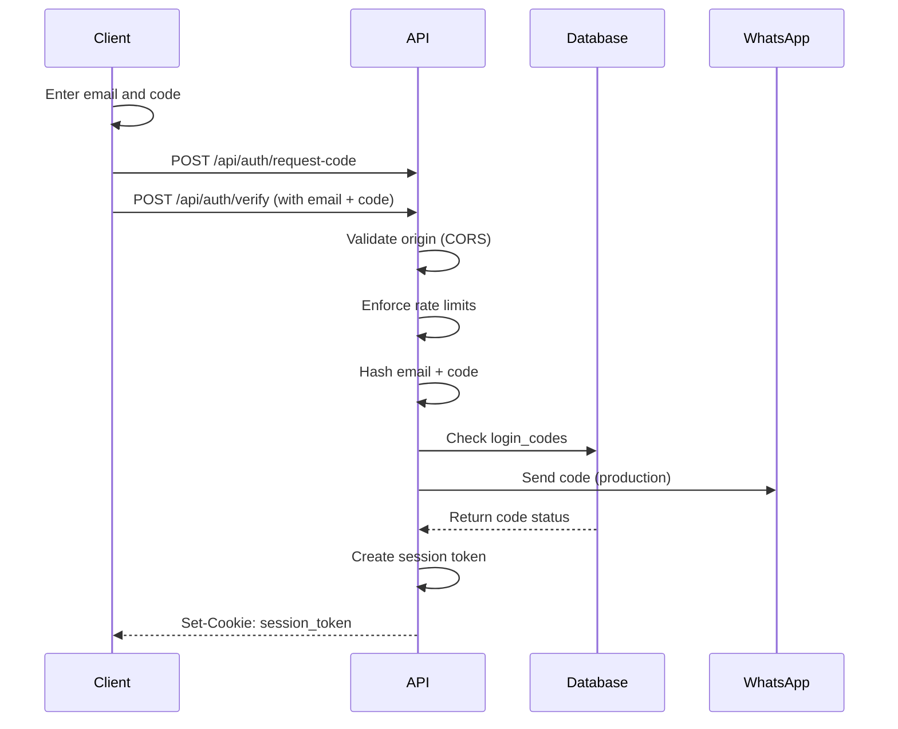

# API REFERENCE

This document provides comprehensive documentation for all API endpoints, including request payloads, response formats, error handling, and authentication requirements. All endpoints follow REST conventions with JSON responses.

## Authentication Overview

Authentication in ClickMenu is handled through email/passwordless sign-in with 6-digit codes sent via WhatsApp (or displayed during development). Upon successful verification, a secure session token is issued and stored in an HTTP-only cookie.

**Session Management**
- Session tokens are cryptographically secure 256-bit random values
- Tokens are stored as SHA-256 hashes in the `sessions` database table (never cleartext)
- Sessions expire after 30 days automatically
- Client-side authentication state is managed separately to protect against CSRF

**Security Headers**


## Rate Limiting

All public endpoints enforce rate limiting using a token bucket algorithm implemented via `lib/rate-limit-store.ts` and enforced through `lib/rate-limit.ts`. Rate limits are configured in the code for each endpoint (e.g., 100 orders per IP per minute).

**Rate Limit Keys**
- `codePerIp` — Number of email code requests per IP (enforced per `POST /api/auth/request-code`)
- `codePerEmail` — Number of code requests per email (enforced per `POST /api/auth/request-code`)
- `verifyPerIp` — Number of successful code verifications per IP (enforced per `POST /api/auth/verify`)
- `orderPerIp` — Number of order submissions per IP (enforced per `POST /api/orders`)

## Common Response Shapes

**Success Response**
```json
{
  "success": true,
  "data": { /* specific endpoint payload */ }
}
```

**Error Response**
```json
{
  "error": {
    "code": "ERROR_CODE",
    "message": "Human-readable error description",
    "details": {}
  }
}
```

**Status Codes**
- `200` — Success
- `201` — Created (e.g., order creation)
- `400` — Bad Request (validation error)
- `404` — Not Found (resource not found)
- `409` — Conflict (optimistic locking violation, duplicate slug)
- `500` — Internal Server Error

## Public Endpoints

### GET `/api/catalog`

Retrieves a restaurant's public menu catalog. This is the primary endpoint customers use to browse and order. If no `shop` parameter is provided, a default seed catalog is returned for demo purposes.

**Query Parameters**
| Parameter | Type | Required | Description |
|-----------|------|----------|-------------|
| `shop` | string | No | Restaurant identifier: can be either `(owner_id)` or `(slug)`. If not present, returns demo catalog. |

**Request Example**
```http
GET /api/catalog?shop=olive-and-ember
```

**Success Response (200)**
```json
{
  "id": "owner-uuid-or-slug",
  "payload": {
    "title": "Olive & Ember Café",
    "categories": [
      {
        "uuid": "category-1",
        "name": { "en": "Coffee", "fr": "Café", "ar": "قهوة" },
        "items": [
          {
            "uuid": "item-1",
            "name": { "en": "Espresso", "fr": "Expresso", "ar": "إسبريسو" },
            "description": { "en": "Rich, dark Italian-style coffee.", "fr": "Café intense et sombre.", "ar": "قهوة غنية ومعتقة من إيطاليا." },
            "price": 25,
            "currency": "MAD",
            "options": [
              {
                "uuid": "option-1",
                "name": { "en": "Size", "fr": "Taille", "ar": "الحجم" },
                "choices": [
                  { "uuid": "choice-1", "name": { "en": "S", "fr": "S", "ar": "ص" }, "priceModifiers": { "sizeS": 0 } },
                  { "uuid": "choice-2", "name": { "en": "M", "fr": "M", "ar": "م" }, "priceModifiers": { "sizeM": 5 } }
                ]
              }
            ],
            "images": [
              { "id": "image-uuid", "viewport": "large", "contentType": "image/jpeg" }
            ]
          }
        ]
      }
    ],
    "linkName": "olive-and-ember",
    "settings": {
      "address": "123 Rue Hassan II, Casablanca",
      "hours": { "fr": "8:00 AM - 8:00 PM" },
      "whatsapp": "+212600000000",
      "currency": "MAD"
    }
  },
  "revision": 3,
  "updatedAt": 1700000000000
}
```

**Error Responses**
- `400 Bad Request` — Invalid restaurant link format
```json
{
  "error": {
    "code": "INVALID_SHOP",
    "message": "Invalid restaurant link."
  }
}
```

- `404 Not Found` — Restaurant not found
```json
{
  "error": {
    "code": "RECIPE_NOT_FOUND",
    "message": "This restaurant menu has not been published yet."
  }
}
```

### POST `/api/orders`

Submits a customer order for a restaurant. The endpoint validates order payload against the current catalog state (including price checks and availability) to prevent "shadow menu" attacks.

**Request Body**
| Field | Type | Required | Description |
|-------|------|----------|-------------|
| `shop` | string | No | Restaurant identifier (either `owner_id` or `slug`). Required for customer orders. |
| `items` | array | Yes | Array of cart items with `uuid`, `quantity`, and `options` choices. |
| `customerName` | string | Yes | Customer name for the order. |
| `deliveryType` | "pickup" \| "delivery" | Yes | Order type. |
| `notes` | string | No | Customer notes for the restaurant. |
| `language` | "en" \| "fr" \| "ar" | Yes | UI language in which the order message will be constructed. |
| `pickupTime` | string (ISO 8601) | Conditional | Required when `deliveryType` is "pickup". |
| `pickupLocation` | string | Conditional | Required when `deliveryType` is "delivery". |

**Request Example**
```json
{
  "shop": "olive-and-ember",
  "customerName": "Ahmed Benali",
  "deliveryType": "pickup",
  "notes": "Make it spicy!",
  "language": "fr",
  "pickupTime": "2026-11-23T14:00:00+01:00",
  "items": [
    {
      "uuid": "item-1",
      "quantity": 2,
      "options": [
        {
          "uuid": "option-1",
          "choices": [{ "uuid": "choice-1" }]
        }
      ]
    },
    {
      "uuid": "item-2",
      "quantity": 1,
      "options": [
        {
          "uuid": "option-2",
          "choices": [{ "uuid": "choice-1" }]
        }
      ]
    }
  ]
}
```

**Success Response (201)**
```json
{
  "id": "order-id-here-32-chars"
}
```

**Error Responses**

- `400 Bad Request` — Validation failure (e.g., invalid UUIDs, negative quantities)
```json
{
  "error": {
    "code": "INVALID_ORDER_PAYLOAD",
    "message": "Missing or invalid 'pickupTime' for pickup orders."
  }
}
```

- `404 Not Found` — Restaurant not found or menu not published
```json
{
  "error": {
    "code": "RECIPE_NOT_FOUND",
    "message": "This restaurant menu was not found."
  }
}
```

- `429 Too Many Requests` — Rate limit exceeded
```json
{
  "error": {
    "code": "RATE_LIMIT_EXCEEDED",
    "message": "Too many order requests. Try again in a minute."
  }
}
```

## Authenticated Endpoints for Restaurant Owners

Authentication is required for all admin API endpoints. The authorization token is sent in the HTTP-only cookie header with the name `session_token`.

### GET `/api/admin/me`

Current user profile for authenticated owner.

**Request Headers**
```
Cookie: session_token=<encrypted-token>
```

**Success Response (200)**
```json
{
  "user": {
    "id": "user-uuid",
    "name": "owner@example.com",
    "email": "owner@example.com"
  }
}
```

**Error Responses**
- `401 Unauthorized` — No valid session token provided

### GET `/api/admin/catalog`

Retrieves the restaurant's complete catalog for editing. If no catalog exists for the owner, a seeded demo catalog is returned.

**Request Headers**
```
Cookie: session_token=<encrypted-token>
```

**Success Response (200)**
```json
{
  "id": "owner-uuid",
  "payload": { /* Full catalog structure (same as public catalog) */ },
  "revision": 3,
  "updatedAt": 1700000000000
}
```

**Error Responses**
- `401 Unauthorized` — No valid session token

### PUT `/api/admin/catalog`

Saves changes to the restaurant catalog. This endpoint performs optimistic locking by comparing the submitted `revision` number with the current one. If another owner has edited the catalog during your session, the request fails with a `409 Conflict`.

**Request Headers**
```
Cookie: session_token=<encrypted-token>
Origin: https://your-restaurant.com
```

**Request Body**
```json
{
  "id": "owner-uuid",
  "payload": {
    "title": "Updated Café Name",
    "categories": [...],
    "linkName": "updated-slug",
    "settings": {
      "address": "Updated address here",
      "whatsapp": "+212600000000",
      /* ... */
    }
  },
  "revision": 5
}
```

**Success Response (200)**
```json
{
  "id": "owner-uuid",
  "payload": { /* Updated catalog */ },
  "revision": 6,
  "updatedAt": 1700000001000
}
```

**Error Responses**

- `400 Bad Request` — Invalid catalog structure (see `lib/catalog-validation.ts`)
```json
{
  "error": {
    "code": "INVALID_CATALOG",
    "message": "Category name contains invalid characters."
  }
}
```

- `409 Conflict` — Another owner edited the catalog concurrently
```json
{
  "error": {
    "code": "OPTIMISTIC_LOCK_VIOLATION",
    "message": "Save failed: catalog has been modified by another owner. Please refresh and retry."
  }
}
```

- `400 Bad Request` — Duplicate slug (another restaurant claimed this link name)
```json
{
  "error": {
    "code": "DUPLICATE_SLUG",
    "message": "The link name 'new-slug' is already taken. Please choose another."
  }
}
```

- `401 Unauthorized` — No valid session token

### GET `/api/admin/orders`

Retrieves all orders for the authenticated restaurant, sorted by creation time with the newest first.

**Request Headers**
```
Cookie: session_token=<encrypted-token>
```

**Success Response (200)**
```json
{
  "orders": [
    {
      "id": "order-id-1",
      "createdAt": 1700000000000,
      "payload": {
        "language": "en",
        "customerName": "Fatima Zahra",
        "deliveryType": "delivery",
        "items": [
          {
            "uuid": "item-1",
            "quantity": 3,
            "variants": [{ "uuid": "choice-1", "name": { "en": "Hot" } }],
            "price": 75
          }
        ],
        "total": 150,
        "pickupTime": "2026-11-23T19:00:00+01:00",
        "pickupLocation": "123 Rue Hassan II, Apt 4B, Casablanca",
        "notes": "VIP order, please"
      },
      "ownerId": "restaurant-owner-uuid"
    },
    {
      "id": "order-id-2",
      "createdAt": 1700000000500,
      "payload": { /* ... */ }
    }
  ]
}
```

**Error Responses**
- `401 Unauthorized` — No valid session token

### PATCH `/api/admin/orders`

Updates the status of an order. Supported status values are `new`, `preparing`, `done`, or `cancelled`.

**Request Headers**
```
Cookie: session_token=<encrypted-token>
Origin: https://your-restaurant.com
```

**Request Body**
```json
{
  "id": "order-id-1",
  "status": "preparing"
}
```

**Success Response (200)**
```json
{
  "id": "order-id-1",
  "status": "preparing",
  "updatedAt": 1700000002000
}
```

**Error Responses**

- `400 Bad Request` — Invalid status value
```json
{
  "error": {
    "code": "INVALID_STATUS",
    "message": "Status must be one of: new, preparing, done, cancelled."
  }
}
```

- `404 Not Found` — Order not found for this restaurant
```json
{
  "error": {
    "code": "ORDER_NOT_FOUND",
    "message": "Order not found."
  }
}
```

- `401 Unauthorized` — No valid session token

### POST `/api/admin/images`

Uploads a restaurant image to be served via the `/api/images/[id]` proxy endpoint. Images are currently stored directly in PostgreSQL (future: migration to Cloudinary or S3).

**Request Headers**
```
Cookie: session_token=<encrypted-token>
Origin: https://your-restaurant.com
Content-Type: multipart/form-data
```

**Request Body (FormData)**
| Field | Type | Required | Description |
|-------|------|----------|-------------|
| `file` | File | Yes | Image file (JPEG, PNG, WEBP) |
| `contentType` | string | Yes | MIME type to store (e.g., `image/jpeg`) |

**Success Response (200)**
```json
{
  "id": "image-uuid-32-chars",
  "ownerId": "restaurant-owner-uuid",
  "contentType": "image/jpeg",
  "byteLength": 45321,
  "createdAt": 1700000000000
}
```

**Error Responses**
- `401 Unauthorized` — No valid session token
- `413 Payload Too Large` — Image exceeds allowed size (currently no explicit limit; depends on PostgreSQL size limit)

## Authentication Endpoints

Two-step email/passwordless authentication has three endpoints: request code, verify code, and sign out.

### POST `/api/auth/request-code`

Sends a 6-digit code to the owner's email via WhatsApp (Resend API) for verification. During development in `npm run dev`, the code is displayed on screen instead of sent.

**Request Body**
```json
{
  "email": "owner@email.com"
}
```

**Success Response (200)**
```json
{
  "sent": true,
  "devCode": null  // Only present during development when RESEND_API_KEY is not set
}
```

**Development Response**
```json
{
  "sent": true,
  "devCode": "123456"  // Code displayed on screen in case WhatsApp is not configured
}
```

**Error Responses**
- `400 Bad Request` — Invalid email format
- `500 Service Unavailable` — During production when Resend API key is missing
```json
{
  "error": {
    "code": "RESEND_NOT_CONFIGURED",
    "message": "Email sign-in isn't set up yet. The site owner needs to add RESEND_API_KEY and EMAIL_FROM."
  }
}
```

### POST `/api/auth/verify`

Verifies the email and code combination to create or extend an owner session. If the owner has previously created a menu via ChatGPT sign-in, their existing catalog can be preserved by using the same email address.

**Request Body**
```json
{
  "email": "owner@email.com",
  "code": "123456"
}
```

**Success Response (200)**
```http
Set-Cookie: session_token=<encrypted-session-token>; HttpOnly; Secure; SameSite=Lax; Path=/; Max-Age=2592000

{
  "user": {
    "id": "user-uuid",
    "name": "owner@email.com",
    "email": "owner@email.com"
  }
}
```

**Error Responses**

- `401 Unauthorized` — Invalid or expired code
```json
{
  "error": {
    "code": "INVALID_CODE",
    "message": "The code is invalid or expired. Please request a new one."
  }
}
```

- `429 Too Many Requests` — Too many verification attempts
```json
{
  "error": {
    "code": "RATE_LIMIT_EXCEEDED",
    "message": "Too many login attempts. Please restart. Wait 1 minute."  // Actually same message per code
  }
}
```

### POST `/api/auth/signout`

Invalidates the current session and clears the cookie.

**Request Headers**
```
Cookie: session_token=<encrypted-token>
Origin: https://your-restaurant.com
```

**Success Response (200)**
```http
Set-Cookie: session_token=; Max-Age=0; Path=/

{
  "signedOut": true
}
```

**Error Responses**
- `401 Unauthorized` — No valid session token

## Utility Endpoints

### GET `/api/health/db`

Health check for database connectivity. Monitors Neon PostgreSQL availability for deployment monitoring.

**Success Response (200)**
```json
{
  "success": true,
  "database": "Neon PostgreSQL"
}
```

**Error Response (500)**
```json
{
  "success": false
}
```

### GET `/api/images/[id]`

Serves an image stored in the `menu_images` table. This is a read-only proxy for binary image data.

**URL Parameters**
| Parameter | Type | Required | Description |
|-----------|------|----------|-------------|
| `id` | string | Yes | Image UUID (32-character string matching `IMAGE_ID_PATTERN`). |

**Success Response (200)**
```http
Content-Type: image/jpeg
Content-Length: 45321

[data bytes]
```

**Error Responses**
- `404 Not Found` — Invalid image ID or image not found
```json
{
  "error": {
    "code": "IMAGE_NOT_FOUND",
    "message": "Photo not found."
  }
}
```

## Security Considerations

### CORS Enforcement

All API endpoints validate the `Origin` header against the allowed site URL (configured via `SITE_URL`). This prevents cross-site request forgery (CSRF) attacks by ensuring API requests come from the application itself.

**Implementation**: `lib/api-security.ts` contains `assertSameOrigin()` which throws an `ApiError(403)` if the origin does not match.

### Rate Limiting

Rate limiting protects against abuse of endpoints like order submission (`100 orders per IP per minute`). Each rate limit key includes an IP address to prevent a single attacker from flooding the system from multiple sources.

**Implementation**: `lib/rate-limit-store.ts` stores rate limit counters in PostgreSQL, making the store shared across server instances.

### Data Validation

Input validation happens at three levels:
1. **Schema validation** — JSON payloads are bounded in size (e.g., order payloads limited to 20KB) to prevent memory-exhaustion attacks.
2. **Business logic validation** — Order items are validated against current catalog state, ensuring price accuracy.
3. **Database constraints** — Foreign keys, unique indexes, and type checks enforce integrity at the database level.

### Session Security

Authentications related values are cryptographically hashed:
- Email codes stored as SHA-256 hashes of `{email}:{code}`
- Session tokens stored as SHA-256 hashes in the `sessions` table (the actual token is used for cookie signing and transport)
- SMTP/WhatsApp message content never includes cleartext secrets

### Subject Origin Checks

The `POST /api/orders` endpoint checks the restaurant exists and reporting-scope-bound-by-owner (A47). Note: There is no API key-based auth for admin endpoints yet for order queues (A47). Future: see deploying multi-instance vs. single-instance efforts.

### Error Handling

API errors are returned in a consistent format:
```json
{
  "error": {
    "code": "ERROR_CODE",
    "message": "Human-readable message",
    "details": {}  // Optional additional context
  }
}
```

Error codes are used for programmatic error handling in the dashboard (e.g., showing user-friendly messages vs. server errors). All errors include a 400, 404, 409, or appropriate HTTP status code.

## Known Issues and Future Enhancements

### Phase 1 Limitations (Current)
- No admin API key-based authentication (A47: multi-instance owner view coordination)
- Image proxy does not implement chunked responses or range requests (future: see "Chunked Responses" in Phase 2)
- Rate limits defined in `lib/rate-limit-store.ts` do not support a unified default, forcing authors to define limits in code (future: see ADR-001B: Sliding Window Rate Limiting)

### Phase 2 Planned Enhancements
- Add status and `updatedAt` columns to `orders` for dedicated status tracking (instead of payload inclusion)
- Implement `isOrderLatest` computed column/flag for the recent unsold, uncanceled order for owner quick-view
- Add and use an additional `ordersTokens` table for distributed metrics (expanded to compute-bounded token generation)

### Phase 3 Future Vision
- Add PostgreSQL-based rate limits for admin APIs (A47)
- Implement Sliding Window Rate Limiting for accuracy, more compactness, and efficiency
- Add audit trails for catalog changes and order updates
- Implement chunked responses for large image serving (Cloudinary/S3)
- Add search/filter capability to `orders` by language, item category, or time window

## Transition Strategy

Database schema changes will be managed through Drizzle ORM with migration generation (`npm run db:generate`) and application rollout using CI/CD. API contracts may be extended through versioned endpoints (e.g., `/api/v2/orders`) while maintaining backward compatibility for existing customers.

Deprecated endpoints will be logged intentionally but kept functional for a grace period to allow gradual migration. Immediately retiring an endpoint mid-summer is expressly discouraged.