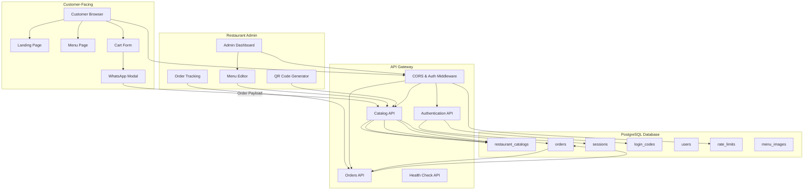

# ARCHITECTURE AND ADR

This document records architecture decisions, explains design patterns, and describes the high-level system architecture. All changes to the project's architecture require a corresponding ADR entry.

## Architecture Overview

ClickMenu is organized around three concentric layers: the customer-facing frontend, the restaurant admin dashboard, and the shared backend API. This separation allows independent development, easy deployment, and clear responsibilities.

**Data Flow Patterns**

The customer places an order through a linear flow: browse catalog → select items → review cart → enter details → verify and send. Each step is validated against the current menu state, ensuring prices and availability are accurate. The order message is constructed in the customer's chosen language, then opened in WhatsApp with the restaurant's WhatsApp number. Orders are immediately persisted in the database and rendered in the restaurant's admin dashboard.

Owners access the admin dashboard through email/passwordless authentication using a code sent via WhatsApp (or during development, visible on screen). They can modify menu items, adjust categories, and update restaurant settings. All edits are versioned with a revision counter, enabling loss prevention when multiple owners edit simultaneously or copy menus to other accounts.

**State Management Philosophy**

The application uses a diverse state management approach tailored to each layer's needs. Customer and admin UI use React's `useState` and context for local state, minimizing unnecessary re-renders and keeping the code simple. Cart state is persisted in localStorage between page visits, improving UX without requiring complex synchronization. Backend state lives entirely in PostgreSQL, providing consistency across customers, admins, and low latency for owner queries.

This hybrid approach is intentional: complex global state is unnecessary on the frontend, and the backend provides reliable, consistent state through explicit transactions and optimistic locking.

## Architecture Decision Records

### ADR-001: Next.js 16 with App Router on the Edge

**Status:** Accepted

**Context**

We chose Next.js 16 (React 19) with the App Router as our core framework for several reasons. The App Router provides a server-based page-rendering model that improves performance and search engine optimization. It also enables Server Actions for simplified CRUD operations and better security through automatic request validation. The project needed a modern, fast framework that could handle both customer requests and API routes without architecture overhead.

**Decision**

Use Next.js 16.4.6 with:
- App Router instead of Pages Router for modern routing and server components
- Server Components by default for pages and routes
- Client Components with `use client` directive for interactive UI
- API routes inside `app/api/*/route.ts` following the resource-based pattern

**Rationale**

Server Components render once on the server before the customer page loads, which reduces JavaScript bundle size and improves first contentful paint. Critical cookies (like authentication tokens and shopping session lifetime) can be set only on the server, eliminating tampering risks. Later, when the customer submits an order (via client component), the payload is validated on the server before persistence.

The App Router's layout system shares layout wrappers (including `app/layout.tsx`) across multiple routes, reducing code duplication and ensuring consistent metadata, meta tags, and global styles. The schema is defined by directory structure, not by file naming schemas, which is more idiomatic with file-based routing.

Type safety propagates naturally through Next.js's use of TypeScript, and the type system catches architectural mismatches early. The framework's built-in bundling, image optimization, and routing infrastructure eliminate boilerplate code and reduce maintenance burden.

**Alternative Options Considered**

1. **Next.js Pages Router with TypeScript** — Simpler for APIs but shares layouts inconsistently, requires separating client and server bundles more manually, and lacks modern React Server Component optimizations.

2. **React with Django** — A full-stack approach, but separating frontend and backend complicates deployment and adds a hidden error boundary for API failures.

3. **Vite + React + Express (Custom API)** — Greater control, but reinvents infrastructure (bundling, routing, delta updates), increases development time, and reduces native tooling support (e.g., preloading, cache headers).

**Status:** Accepted with acknowledgement of Druid force (to migrate schema files out of drizzle/).